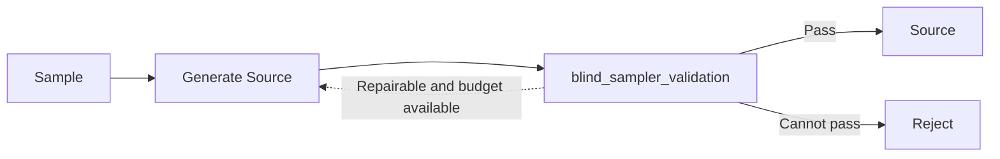
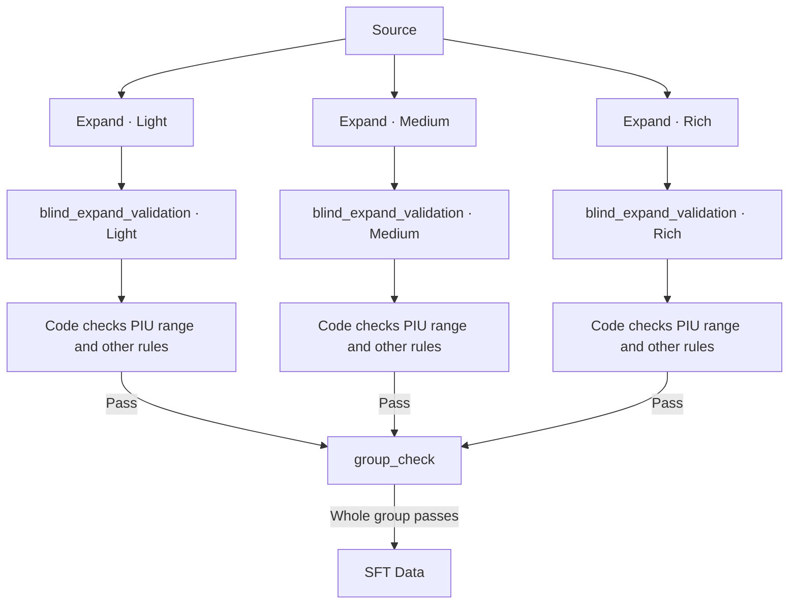

# MidasData

[中文](README.md) | **English**

MidasData builds SFT data for converting user image descriptions into English image prompts. It generates Source descriptions that simulate real user input, independently produces Light, Medium, and Rich expansions of each Source, and exports training samples after validation.

Sources can be Chinese, English, or mixed Chinese/English, with default sampling favoring Chinese. Expansion levels control how much visual information is added relative to the Source; all three levels must preserve its original facts and constraints.

## Tasks and responsibilities

The project has four model tasks and one programmatic group check organized into two main workflows. A PIU is a distinct visual fact identifiable in the text. An added PIU must introduce a visual distinction that the source neither expresses nor necessarily implies.

| Module | Responsibility | Core requirements |
| --- | --- | --- |
| Generate Source | Generate an image request resembling real user input from sampled conditions | Match the supplied `domain`, `focus`, `specificity`, `expression`, and `language` conditions, maintain naturalness and diversity, and omit sampling labels and metadata |
| blind_sampler_validation | Check whether the Source satisfies its sampled conditions | Check only supplied dimensions, assess visual content, language, expression, and text validity, and return judgments with source evidence |
| Expand | Expand the Source toward a sampled number of added PIUs | Python uniformly samples an integer `target_added_pius` from the level's range; the model receives only the Source and target count and returns `prompt`, without a level or range |
| blind_expand_validation | Independently judge expansion semantics and identify additions | The model sees only the Source and expanded text and returns `passed`, `reason`, and `added_pius`; code checks the count range, evidence, duplicates, and basic format |
| group_check | Confirm group acceptance in code | Require Light, Medium, and Rich to be present and individually passed, then commit the group without a model call |

The `generator` role handles Generate Source and Expand; the `validator` role handles the two blind validation tasks. The roles can use the same or different models. Expansion blind validation receives no level, target count, or range. Count decisions use only its independently identified additions. Default ranges are Light 0, Medium 2–4, and Rich 5–8; acceptance still requires the count to fall within the level's range, without requiring an exact match to the sampled target.

## Two main workflows

### Source Generation

Sampling determines task conditions. The generator chooses a visual concept and writes a description, then the validator checks the conditions and text. A passing description becomes a Source available for expansion.

Revisions preserve sampled conditions and retain the visual concept where possible. Tasks are sampled and persisted before model calls, and rejected tasks are not replaced. The distribution of passing samples can therefore differ from the planned distribution.

### Expansion

Each level independently generates and validates an expansion from the same Source. A target count is sampled at the start for each level, and all generation attempts use that Source and fixed target. Once every level passes semantic blind validation and code checks, `group_check` confirms group completeness.

A level that fails semantic or code checks is generated again using its original target count, then blindly validated. Generation requests always contain only the Source and target count. Exhausting a generation or technical request budget rejects the entire group, as does a failed `group_check`. Only three passing levels produce the expansion records and SFT data. Levels may choose different additions without inheriting earlier levels' text.

Source Generation and Expansion can run separately, and Expansion also accepts external Sources. The implementation's `expansion_attempt` is a reusable subgraph inside Expansion that generates and validates once. Expansion levels consistently use `level`.

## Quality and run records

Models judge semantics, identify added visual facts, and provide evidence. Code uses the blind report to accept, regenerate, or reject, checking count ranges, duplicates, evidence location, and basic format. PIU segmentation, implied meaning, and addition validity still depend on model judgments and require human calibration. Results retain the generation target and blind report, with no PIU indices. Expansion regeneration, technical retries, and resume always use the originally sampled target count.

Generation and technical request retries have separate budgets. Each Source and each expansion level allow at most three generations. A logical model operation allows at most five request attempts. Without retries, an expansion group requires three generation calls and three blind validation calls: six model requests. Runs save model responses, quality decisions, and terminal results; recovery reuses history and preserves consumed budgets.

## Documentation

| Document | Content |
| --- | --- |
| [Workflow design](docs/workflows.en.md) | State, nodes, routes, and builders for the two main workflows and internal subgraph, execution layers, and recovery |
| [Sampling design](docs/sampler.en.md) | Five dimensions, default distributions, dropout, and Source diversity |
| [Validation rules](docs/validation.en.md) | Source validity, PIU definitions, blind validation, code decisions, and group acceptance conditions |
| [Data contracts](docs/data.en.md) | Source, expansion, and SFT structures, run records, and provenance |
| [Running the project](docs/running.en.md) | Environment, configuration, commands, previews, and essential tests |
