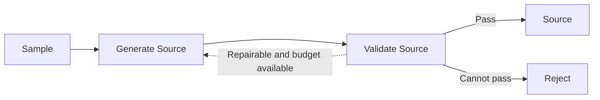
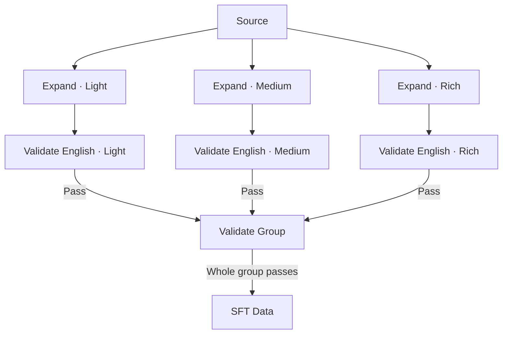

# MidasData

[中文](README.md) | **English**

MidasData builds SFT data for converting user image descriptions into English image prompts. It generates Source descriptions that simulate real user input, independently produces Light, Medium, and Rich expansions of each Source, and exports training samples after validation.

Sources can be Chinese, English, or mixed Chinese/English, with default sampling favoring Chinese. Expansion levels control how much visual information is added relative to the Source; all three levels must preserve its original facts and constraints.

## Tasks and responsibilities

The project has five model tasks organized into two main workflows. A PIU is a distinct visual fact identifiable in the text. An added PIU must introduce a visual distinction that the source neither expresses nor necessarily implies.

| Module | Responsibility | Core requirements |
| --- | --- | --- |
| Generate Source | Generate an image request resembling real user input from sampled conditions | Match the supplied `domain`, `focus`, `specificity`, `expression`, and `language` conditions, maintain naturalness and diversity, and omit sampling labels and metadata |
| Validate Source | Check whether the Source satisfies its sampled conditions | Check only supplied dimensions, assess visual content, language, expression, and text validity, and return judgments with source evidence |
| Expand | Convert and expand the Source into an English image prompt | Preserve the source meaning; by default add 0 valid PIUs for Light, 2–4 for Medium, and 5–8 for Rich; return only the prompt |
| Validate English | Independently validate each expansion level | Check original PIU preservation, semantic contradictions, the validity and count of added PIUs, and output format |
| Validate Group | Jointly validate the three expansions of one Source | Use a shared segmentation of original PIUs, reassess all three levels against their required counts, and identify levels needing revision |

The `generator` model role handles Generate Source and Expand. The `validator` role handles the three validation tasks. The roles can use the same or different models; individual and group validation run separately.

## Two main workflows

### Source Generation

Sampling determines task conditions. The generator chooses a visual concept and writes a description, then the validator checks the conditions and text. A passing description becomes a Source available for expansion.

Revisions preserve sampled conditions and retain the visual concept where possible. Tasks are sampled and persisted before model calls, and rejected tasks are not replaced. The distribution of passing samples can therefore differ from the planned distribution.

### Expansion

Each level independently generates and validates an expansion from the same Source, using only the source description and its own revision history. Once all levels pass individual validation, the group is reassessed together.

Individual validation failures trigger revision of the corresponding level; group failures target the levels specified in feedback. Revised outputs are validated again. Exhausted budgets or insufficient expansion space reject the entire group. Only a passing group produces three expansion records and their SFT data. Levels may choose different additions without inheriting earlier levels' text.

Source Generation and Expansion can run separately, and Expansion also accepts external Sources. The implementation's `expansion_attempt` is a reusable subgraph inside Expansion that generates and validates once. Expansion levels consistently use `level`.

## Quality and run records

Models identify visual facts, judge semantics, and provide evidence. Workflow nodes apply deterministic checks to their reports, and routes decide whether to accept, revise, or reject. Evidence location, index coverage, and count constraints can be checked in code. PIU segmentation, implied meaning, and addition validity still depend on model judgments and require human calibration.

Quality revisions and technical request retries have separate budgets. Each Source allows at most three generations, and each expansion level allows at most three generations shared between individual and group revisions. A logical model operation allows at most five request attempts. Runs save model responses, quality decisions, and terminal results; recovery reuses history and preserves consumed budgets.

## Documentation

| Document | Content |
| --- | --- |
| [Workflow design](docs/workflows.en.md) | State, nodes, routes, and builders for the two main workflows and internal subgraph, execution layers, and recovery |
| [Sampling design](docs/sampler.en.md) | Five dimensions, default distributions, dropout, and Source diversity |
| [Validation rules](docs/validation.en.md) | Source validity, PIU definitions, evidence requirements, and individual and group validation |
| [Data contracts](docs/data.en.md) | Source, expansion, and SFT structures, run records, and provenance |
| [Running the project](docs/running.en.md) | Environment, configuration, commands, previews, and essential tests |
