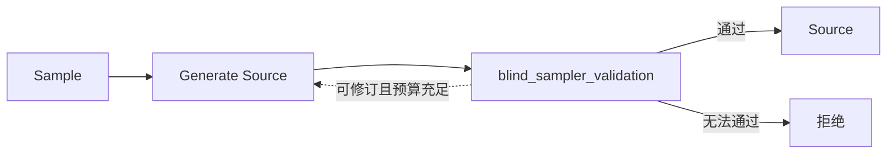
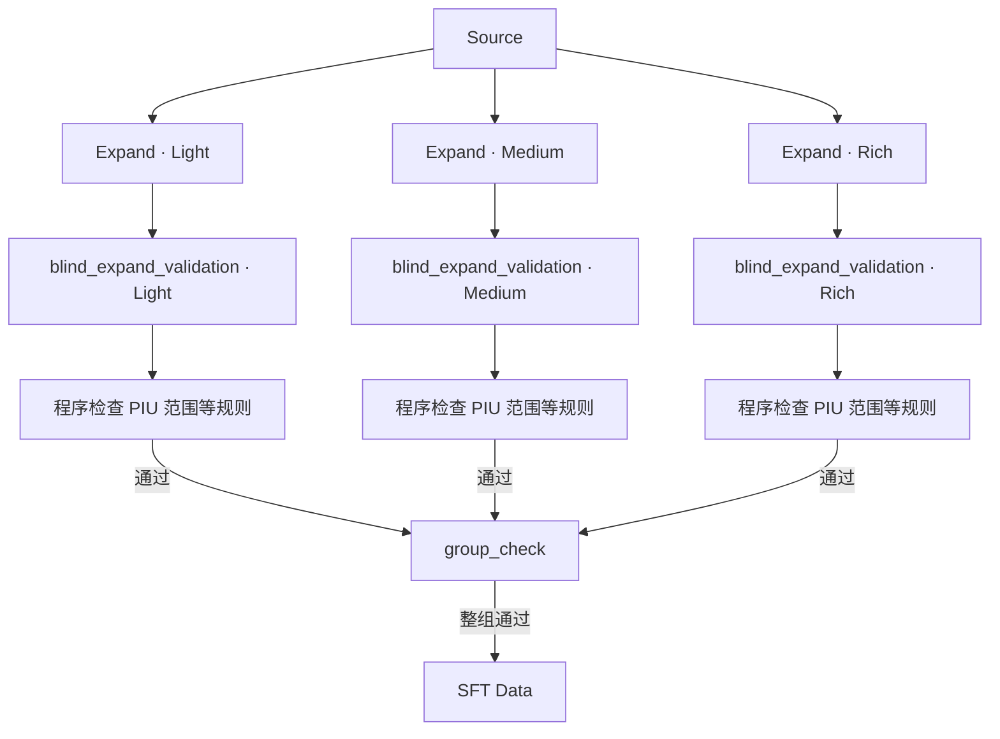

# MidasData

**中文** | [English](README.en.md)

MidasData 构造从用户图像描述到英文图像提示词的 SFT 数据。它先生成模拟真实用户输入的 Source，再围绕同一 Source 独立生成 Light、Medium、Rich 三档扩写，通过校验后导出训练样本。

Source 可以是中文、英文或中英混合，默认采样以中文为主。扩写等级控制相对 Source 新增的视觉信息量；三档都必须保留原始事实与约束。

## 任务与职责

项目包含四个模型任务和一个程序组检查，由两个主工作流组织。PIU 是文本中可识别的独立视觉事实；新增 PIU 必须引入源描述既未表达、也未必然隐含的视觉区别。

| 模块 | 职责 | 核心要求 |
| --- | --- | --- |
| Generate Source | 根据采样条件生成模拟真实用户的文生图描述 | 符合 `domain`、`focus`、`specificity`、`expression`、`language` 等实际采样条件，保持自然和多样性，不暴露采样标签或元数据 |
| blind_sampler_validation | 检查 Source 是否符合采样条件 | 只检查实际采样的维度，验证视觉内容、语言、表达形式和文本有效性，返回判断与原文证据 |
| Expand | 按抽取的新增 PIU 数量扩写 Source | Python 从对应范围内均匀抽取整数目标 `target_added_pius`；模型只接收 Source 和目标数量，返回 `prompt`，不接收 level 或范围 |
| blind_expand_validation | 独立判断扩写语义并识别新增 PIU | 模型只看 Source 和扩写文本，返回 `passed`、`reason`、`added_pius`；程序检查数量范围、证据、重复项和基本格式 |
| group_check | 用程序确认整组可接受 | 检查 Light、Medium、Rich 是否齐全且各自已经通过；通过后整组提交，不调用模型 |

`generator` 模型角色承担 Generate Source 和 Expand，`validator` 模型角色承担两个盲校验任务。两个角色可以配置相同或不同的模型。扩写盲校验不接收 level、目标数量或范围，数量判定只使用它独立识别的列表。默认范围为 Light 0、Medium 2–4、Rich 5–8；接受条件仍是落在对应范围内，不要求计数恰好等于抽取的目标。

## 两个主工作流

### Source Generation

采样确定任务条件，生成器据此选择视觉概念并生成描述，校验器检查条件与文本。通过后得到可供扩写使用的 Source。

修订保留采样条件，尽量沿用视觉概念。任务在模型调用前完成采样并持久化，拒绝后不补充采样，因此通过样本的分布可能与计划分布不同。

### Expansion

三个 level 分别从同一 Source 出发生成和校验，每档在开始时抽取一个目标数量，所有生成尝试都使用该 Source 和固定目标。全部通过语义盲校验和程序规则后，由 `group_check` 确认整组齐全。

单档的语义或程序规则失败时，按原目标数量重新生成该档位，再独立盲校验。生成请求始终只有 Source 和目标数量。生成预算或技术请求预算耗尽则拒绝整组，`group_check` 检查失败也拒绝整组。只有三档都通过才导出三条扩写记录和对应 SFT 数据。不同等级可以选择不同新增细节，无需逐档继承文本。

Source Generation 与 Expansion 可以分别运行，Expansion 也可以接收外部 Source。实现中的 `expansion_attempt` 是 Expansion 内部复用的“生成一次并校验”子图，扩写等级统一使用 `level`。

## 质量与运行记录

模型负责判断语义、识别新增视觉事实并提供证据；程序根据盲校验报告决定接受、重新生成或拒绝。数量范围、重复项、证据位置和基本格式由程序检查。PIU 切分、隐含语义和新增信息的有效性仍依赖模型判断，需要人工校准。结果保存生成目标与盲校验报告，PIU 不带编号。扩写重生成、技术重试和断点恢复始终使用最初抽取的目标数量。

生成与请求技术重试使用不同预算：每条 Source 最多生成三次，每个扩写等级最多生成三次；一次逻辑模型操作最多尝试五次请求。无重试时，一组扩写需要三次生成和三次盲校验，共六次模型请求。运行保存模型响应、质量决策和终态结果，中断后复用历史并保留已用预算。

## 文档结构

| 文档 | 内容 |
| --- | --- |
| [工作流设计](docs/workflows.md) | 两个主工作流及内部子图的状态、节点、路由、build，执行分层与恢复机制 |
| [采样设计](docs/sampler.md) | 五个维度的含义、默认分布、dropout 与 Source 多样性 |
| [校验规则](docs/validation.md) | Source 有效性、PIU 定义、盲校验与程序判定、整组接受条件 |
| [数据契约](docs/data.md) | Source、扩写和 SFT 的结构，以及运行记录与来源追踪 |
| [运行参考](docs/running.md) | 环境、配置、命令、预览与必要测试 |
