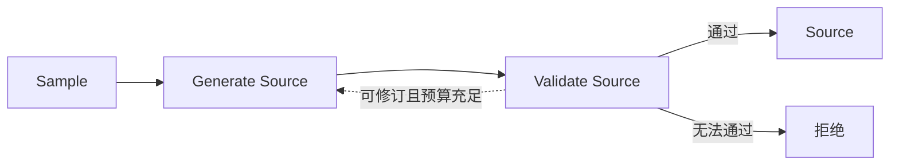
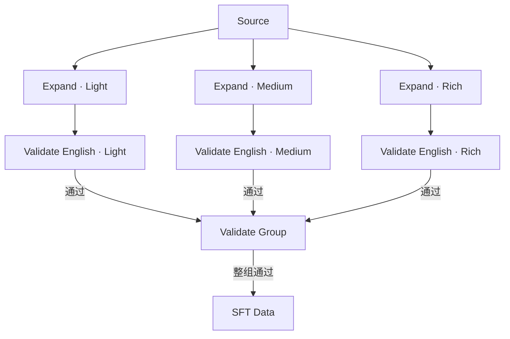

# MidasData

**中文** | [English](README.en.md)

MidasData 构造从用户图像描述到英文图像提示词的 SFT 数据。它先生成模拟真实用户输入的 Source，再围绕同一 Source 独立生成 Light、Medium、Rich 三档扩写，通过校验后导出训练样本。

Source 可以是中文、英文或中英混合，默认采样以中文为主。扩写等级控制相对 Source 新增的视觉信息量；三档都必须保留原始事实与约束。

## 任务与职责

项目包含五个模型任务，由两个主工作流组织。PIU 是文本中可识别的独立视觉事实；新增 PIU 必须引入源描述既未表达、也未必然隐含的视觉区别。

| 模块 | 职责 | 核心要求 |
| --- | --- | --- |
| Generate Source | 根据采样条件生成模拟真实用户的文生图描述 | 符合 `domain`、`focus`、`specificity`、`expression`、`language` 等实际采样条件，保持自然和多样性，不暴露采样标签或元数据 |
| Validate Source | 检查 Source 是否符合采样条件 | 只检查实际采样的维度，验证视觉内容、语言、表达形式和文本有效性，返回判断与原文证据 |
| Expand | 将 Source 转换并扩写为英文图像提示词 | 保留原始语义，默认按 Light 0、Medium 2–4、Rich 5–8 个有效新增 PIU 扩写，只返回提示词 |
| Validate English | 独立验证每个等级的英文扩写 | 检查原始 PIU 保留、语义矛盾、新增 PIU 的有效性与数量，以及输出格式 |
| Validate Group | 联合验证同一 Source 的三个扩写等级 | 统一原始 PIU 的划分，重新检查三个等级，确保各自达到数量要求，并确定需要修订的等级 |

`generator` 模型角色承担 Generate Source 和 Expand，`validator` 模型角色承担三个校验任务。两个角色可以配置相同或不同的模型；单档校验与组校验分别执行。

## 两个主工作流

### Source Generation

采样确定任务条件，生成器据此选择视觉概念并生成描述，校验器检查条件与文本。通过后得到可供扩写使用的 Source。

修订保留采样条件，尽量沿用视觉概念。任务在模型调用前完成采样并持久化，拒绝后不补充采样，因此通过样本的分布可能与计划分布不同。

### Expansion

三个 level 分别从同一 Source 出发生成和校验，每档只使用源描述及自己的修订历史。全部通过单档校验后，再统一复核整组。

单档校验失败时修订对应档位；组校验失败时按反馈修订指定档位。修订完成后重新校验，预算耗尽或扩写空间不足则拒绝整组。只有整组通过才导出三条扩写记录和对应 SFT 数据。不同等级可以选择不同新增细节，无需逐档继承文本。

Source Generation 与 Expansion 可以分别运行，Expansion 也可以接收外部 Source。实现中的 `expansion_attempt` 是 Expansion 内部复用的“生成一次并校验”子图，扩写等级统一使用 `level`。

## 质量与运行记录

模型负责识别视觉事实、判断语义并提供证据；工作流节点根据报告执行确定性检查，路由决定接受、修订或拒绝。证据定位、索引覆盖和数量约束可以由程序检查，PIU 切分、隐含语义和新增信息的有效性仍依赖模型判断，需要人工校准。

质量修订与请求技术重试使用不同预算：每条 Source 最多生成三次，每个扩写等级最多生成三次，单档与组修订共享该等级的预算；一次逻辑模型操作最多尝试五次请求。运行保存模型响应、质量决策和终态结果，中断后复用历史并保留已用预算。

## 文档结构

| 文档 | 内容 |
| --- | --- |
| [工作流设计](docs/workflows.md) | 两个主工作流及内部子图的状态、节点、路由、build，执行分层与恢复机制 |
| [采样设计](docs/sampler.md) | 五个维度的含义、默认分布、dropout 与 Source 多样性 |
| [校验规则](docs/validation.md) | Source 有效性、PIU 定义、证据要求、单档与组校验 |
| [数据契约](docs/data.md) | Source、扩写和 SFT 的结构，以及运行记录与来源追踪 |
| [运行参考](docs/running.md) | 环境、配置、命令、预览与必要测试 |
