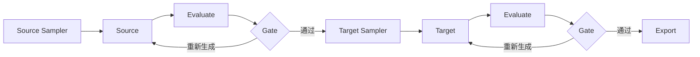

# PairData

[English](README.md) | **中文**

轻量、可配置的 Source–Target 数据合成管道，基于 LangGraph，支持分布采样、LLM 辅助评估和程序质量控制。

每个通过任务只导出一条记录：

```json
{"source": "一只猫趴在窗边", "target": "A cat lying beside a window."}
```

默认样例放在 `recipes/rewrite/`：YAML 定义模型和输入绑定，Source / Target 各自使用独立的 sampler YAML，Jinja2 定义消息，JSON Schema 定义生成与评估响应，YAML 规则决定是否通过。复杂业务示例放在 `examples/`。切换任务无需修改工作流。



Source 和 Target 均可通过 `previous` / `feedback` 绑定上一轮候选与评估、规则反馈。质量失败后在原 sample 下重新生成，Target 同时保留已通过的 Source。两个样例均启用反馈。每阶段只采样一次，技术重试和断点恢复保留已用预算。预算耗尽的任务被拒绝，不补齐任务数。

## 快速开始

需要 Python 3.11+、uv 和支持文件锁、目录 fsync 的 POSIX 环境。

```bash
uv sync --locked
uv run pairdata check
```

在 `.env` 中配置 OpenAI 兼容服务：

```dotenv
MODEL_NAME=your-model
OPENAI_BASE_URL=https://your-service.example/v1
OPENAI_API_KEY=your-secret
```

```bash
uv run pairdata run --count 20 --seed 42 --out runs/rewrite
```

输出包括 `data.jsonl`、`audit.jsonl`、`manifest.json`、`recipe.json` 和可离线打开的 `preview.html`。中断后使用原命令加 `--resume`。

## 默认样例与业务示例

在项目根目录运行时，省略 `--recipe` 默认使用 `recipes/rewrite/recipe.yaml`。复制整个 recipe 目录即可开始配置自己的任务。

| Recipe | 任务 |
| --- | --- |
| [rewrite](recipes/rewrite/recipe.yaml)（默认） | 生成简短消息，再按采样语气改写 |
| [prompt_pairs](examples/prompt_pairs/recipe.yaml)（复杂示例） | 按五维条件生成图像描述，再按采样的新增 PIU 目标生成英文提示词 |

```bash
uv run pairdata check --recipe examples/prompt_pairs/recipe.yaml
uv run pairdata run --recipe examples/prompt_pairs/recipe.yaml --count 20 --out runs/prompt-pairs
```

`prompt_pairs` 每任务采样一个扩写目标，导出一对数据；Target 评估只看到 Source 和 Target，程序检查新增 PIU 列表长度。PIU 的识别、语义一致性和列表中逐项证据的正确性依赖评估模型。

## 文档

- [配置与运行](docs/running.md)：Recipe 契约、消息输入、CLI 与恢复。
- [采样](docs/sampler.md)：加权选项、整数区间、dropout 与分布统计。
- [评估与决策](docs/validation.md)：JSON Schema 与规则操作符。
- [工作流](docs/workflows.md)：节点、预算、并发与执行边界。
- [数据契约](docs/data.md)：业务导出、内部结果和审计追踪。
- [设计文档](docs/architecture.md)：架构和配置边界。

## 检查

```bash
uv run --locked python -m unittest discover -s tests -v
uv run --locked ruff check .
```

测试使用临时目录和模型传输替身，不调用远程服务。
