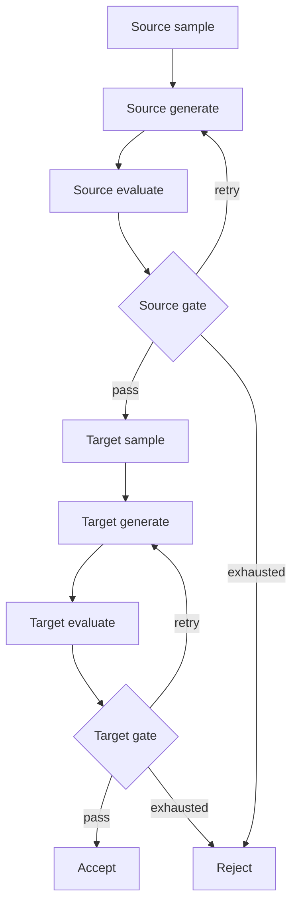

# Workflow

[中文](workflows.md) | **English** · [Home](../README.md)

The fixed graph lives in [pipeline.py](../src/pairdata/workflows/pipeline.py), alongside its state, nodes, routes and builder. Recipes configure behavior; code defines the topology.

Inputs are stable task_id and index. Each stage retains sample, generation_attempt, generation, candidate, evaluation, decision, status and reason. A new generation attempt clears the current candidate and evidence; history remains in Audit.

Both stages may bind previous/feedback for revisions. previous is that stage's prior candidate; feedback contains its evaluation and programmatic decision. Both start as null. Target Generate has the accepted source, its own sample, previous and feedback available. Templates see only explicitly bound variables.

Sampling is persisted before the first generation. Quality retries loop through generate/evaluate/gate only. Target failure preserves the accepted Source. Exhausted technical or generation budgets reject the task.

## Execution layers

| Module | Responsibility |
| --- | --- |
| config / recipe | Load and compile configuration and resources |
| sampler / prompts / validation / rules | Sampling, rendering, structural validation, decisions |
| workflows/pipeline | Fixed nodes, state, generation budgets and routing |
| model | LangChain requests, raw responses, provider error classification |
| execution | Replay, shared semaphore, technical retries, audit events |
| runner | Queue, workers, commits, derived exports |
| storage | Locks, atomic files, audit and snapshots |

Nodes and routes use async entry points, keeping state updates and audit writes on the same event loop instead of implicitly dispatching synchronous nodes to a thread pool.

Logical requests default to five attempts. Connection errors, timeouts, 408/409/429, 5xx and invalid responses may retry. SDK retries are disabled; backoff does not hold a concurrency slot. Other provider errors stop the run. Gate independently records decisions after evaluation parsing succeeds.

## Recovery

Recovery replays uncommitted tasks from the graph entry, without graph checkpoints. Operation identity uses task ID, stage operation and generation attempt. Requests are fsynced before execution, so unknown outcomes consume budget. Saved responses without success events can be revalidated and reused.

Sampling is recorded once per task/stage and checked for consistency on replay. Both accepted and rejected committed tasks are skipped. Exports rebuild in task order. Decisions are not duplicated on replay.

A directory lock prevents concurrent writers. Task and recipe snapshots are digest-checked. Complete invalid audit lines block resume; only an incomplete final append without a newline is discarded.

Worker count also equals concurrency. A task retains its worker during backoff even though it releases the request semaphore; queued tasks wait when all workers are occupied.

Response parsing and schema failures use `ResponseValidationError`. Ordinary local `ValueError` and storage failures are not treated as retryable model output. If execution fails, failures while exporting or rendering the preview are attached to the original exception instead of replacing it.
