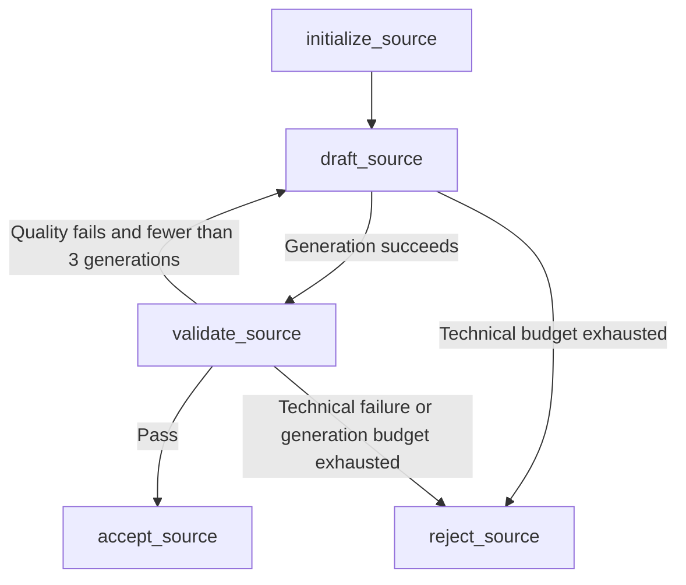
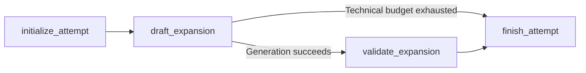
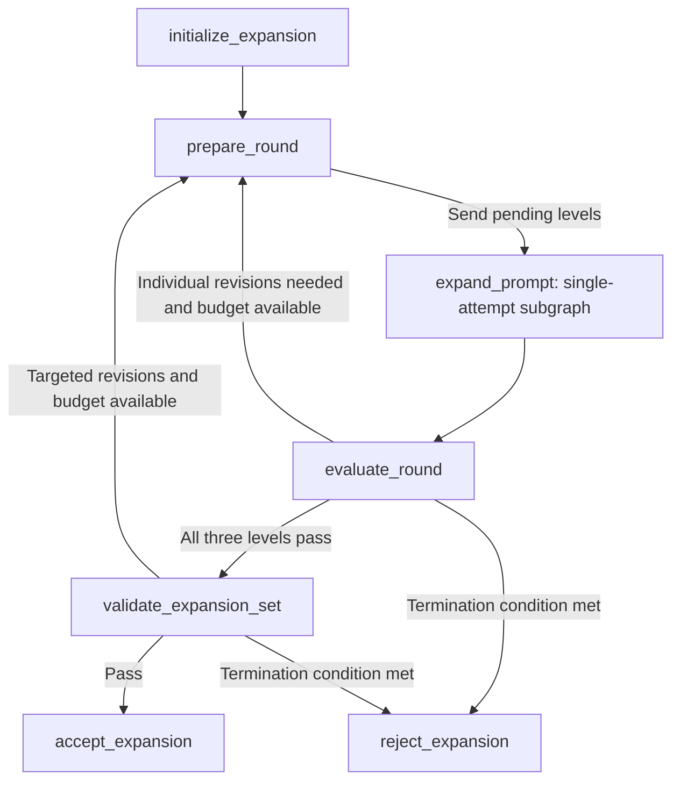
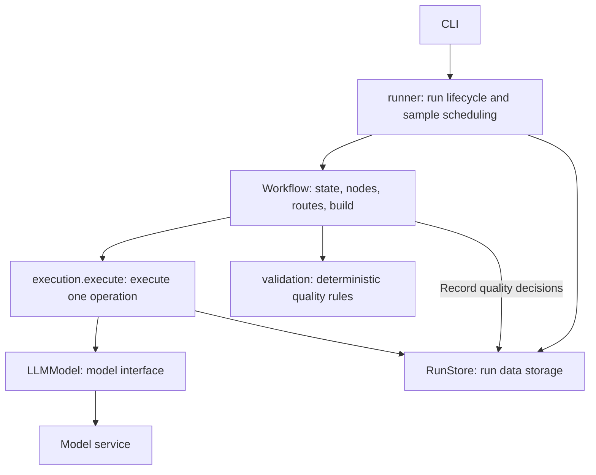

# Workflows and recovery

[中文](workflows.md) | **English** · [Home](../README.en.md)

Workflows use LangGraph `StateGraph` directly. Each module follows **inputs and state → nodes → routes → build**. Nodes return partial state updates, and routes only choose the next node. Compiled graphs can be reused across samples.

| Module | Purpose | State | Builder |
| --- | --- | --- | --- |
| `workflows/source_generation.py` | Generate and revise one visual source description | `SourceGenerationState` | `build_source_generation` |
| `workflows/expansion_attempt.py` | Generate and validate once at a specified level | `ExpansionAttemptState` | `build_expansion_attempt` |
| `workflows/prompt_expansion.py` | Expand three levels in parallel, target revisions, and validate the group | `PromptExpansionState` | `build_prompt_expansion` |

`level` means the Light / Medium / Rich expansion level, with the type `ExpansionLevel`. Workflow state, model calls, and JSONL fields consistently use this name. `expansion_attempt` means one generation and validation attempt at a specified level.

## Source description generation

Inputs are `task_id` and the five-dimensional sampled `conditions`. Runtime state contains the current `concept`, `draft_prompt`, `draft_count`, `validation`, `decision`, `revision_feedback`, `failure_reason`, and terminal `result`.

`planning.source_tasks` determines the task sequence from the seed before concurrent execution. Revisions preserve the sampled conditions and the previous concept without resampling.

Successfully replacing a draft clears its current validation, decision, and feedback. If validation of the new draft fails technically, the result retains the new text without attaching old evidence. If generating a replacement fails, the old text has not been replaced, so it and its corresponding evidence can remain. Historical responses stay in the audit log.

## Single expansion attempt

Inputs include `task_id`, `source_prompt`, `level`, `round_number`, `draft_number`, `previous_prompt`, and `revision_feedback`. Runtime state contains this attempt's `draft_prompt`, `validation`, `decision`, `failure_reason`, and `ExpansionResult`.

This subgraph has no quality revision loop. The parent allocates generation attempts, and the subgraph returns `passed`, `quality_failed`, or `technical_failed`. Failed generation skips validation; technical failure during validation retains the current draft with empty current evidence. Each level receives only the source description and its own previous output, without other levels' text.

## Three-level expansion orchestration

Inputs are `task_id` and `source_prompt`. Runtime state contains `round_number`, `pending_levels`, the latest per-level `expansions`, `feedback_by_level`, `set_validation`, `set_decision`, `failure_reason`, and terminal `result`.

The first round dispatches all three levels; later rounds dispatch only levels needing revision. `merge_expansions` merges parallel results and prevents older rounds from overwriting newer ones. LangGraph waits for all dispatched branches to finish before running `evaluate_round`, which also checks the round number.

`prepare_round` increments the round and clears previous group evidence. `dispatch_attempts` allocates the next `draft_number` for each pending level. Individual quality failures and revisions requested by group validation share a maximum of three generations per level. If any level requiring revision has no remaining budget, the entire group is rejected.

Group validation runs only after all three levels pass individual validation. It uses one shared extraction of source PIUs. An `insufficient_expansion_space` flag at any scope terminates the entire group, after waiting for the current round's parallel attempts to finish. Only a passing group produces the three Light, Medium, and Rich business records and SFT records.

## Model calls and execution boundaries

- `runner.py` creates generator and validator models and a shared `ExecutionContext`, passes dependencies to workflow build functions, and schedules samples.
- Workflow nodes prepare business inputs and prompts and choose a model. After receiving a report, validation nodes explicitly call `assess_source`, `assess_expansion`, or `assess_expansion_set`, save the quality decision, and return state updates. Routes use the result and revision budget to choose the next step.
- `execution.py` provides `execute()`, which receives an async operation returning a persistable dictionary, inputs, audit identifiers, a parser, and retry rules. It checks history, executes the operation, records output, and returns the parsed result. It also supports ordinary operations that do not use a model.
- `model.py` provides `LLMModel`, which holds only one model's configuration and connection and handles requests, interface error classification, and response parsing. It neither reads run history nor accepts quality assessment functions.
- `storage.py` provides `RunStore`, which manages the run lock and saves configuration, tasks, operation records, quality decisions computed by nodes, and committed results.

`ExecutionContext` contains only `store`, a concurrency semaphore, and backoff parameters. It contains no workflow state, model instances, or business rules. Ordinary initialization, round calculations, parallel result merging, and routing happen directly in workflows.

A new operation has no history and starts with its first attempt. When history exists, the execution layer reuses saved outputs or restores the number of attempts already used. Operation output is persisted before parsing and validation. The model's `invoke()` returns a raw response snapshot, and `parse()` parses either new or historical responses, so malformed raw outputs remain in the audit log.

The group validation node supplies `parse_set_report()`, which parses the schema and calls `check_expansion_set_contract()` to check that the three levels, revision list, and feedback are complete and consistent. It returns only the report. After `execute()` returns, the node computes a `QualityDecision` and saves it through `RunStore.record_decision()`. Replay does not append the same quality decision twice.

JSON, schema, and group revision contract errors are technical errors. A structurally valid report that fails quality checks returns normally, and the workflow decides whether to revise generation. Deterministic checks do not guarantee that the model's semantic judgments are correct.

Each operation explicitly specifies retryable errors and its maximum attempts, defaulting to one execution. Model operations allow at most five attempts, including the first. Network errors, timeouts, HTTP 408/409/429, 5xx errors, and invalid responses can be retried; other HTTP errors stop the run. SDK retries are disabled. The execution layer uses an ordinary `for` loop with exponential backoff and jitter. Backoff waits do not occupy concurrency slots.

Sample workers and all parallel levels share one execution semaphore, allowing at most `concurrency` model requests in flight. File writes run synchronously in the event loop, without concurrent writer threads.

## Recovery and versions

Recovery replays uncommitted tasks from the workflow entry point, without graph checkpoints. An operation is identified by task ID, stage name, expansion level, round, and generation number, represented by `logical_call_id`. Saved successful responses are parsed again and reused; a saved raw response alone can also be recovered. Request events are fsynced before requests are sent, so an unknown outcome still consumes a technical attempt.

Recovery requires matching requests, configuration, the sampler, prompt digests, software version, and `WORKFLOW_REVISION`. `concurrency` and preview page size may change; other configuration must remain the same. Run metadata and fingerprints are checked together during recovery.

A complete but invalid audit line or a corrupted task sequence blocks recovery. Only an incomplete final append without a newline is discarded. Committed passed and rejected tasks are both skipped, while exports and previews are rebuilt from committed results.
