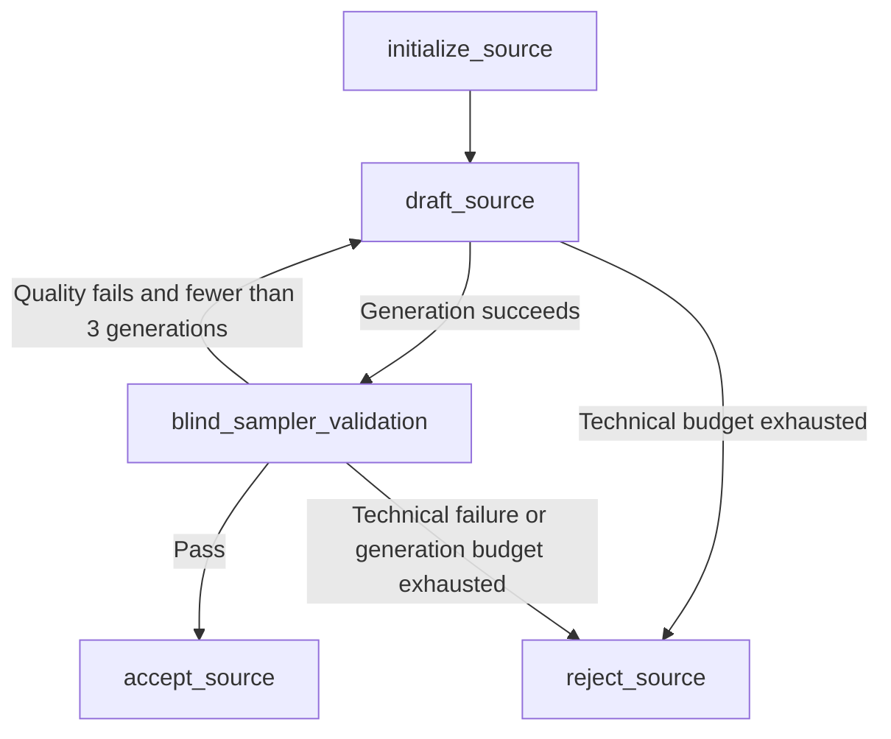
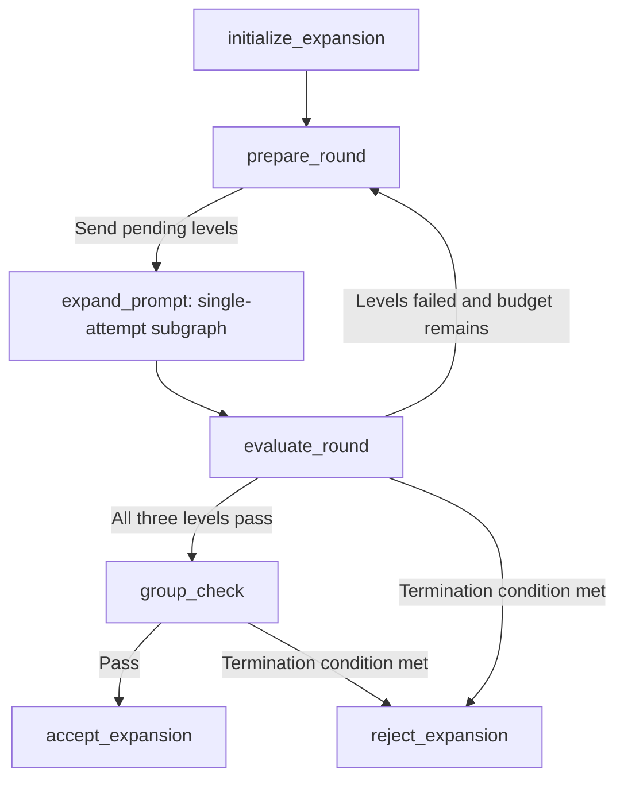
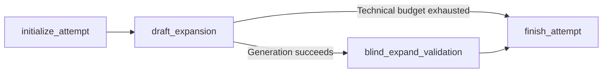
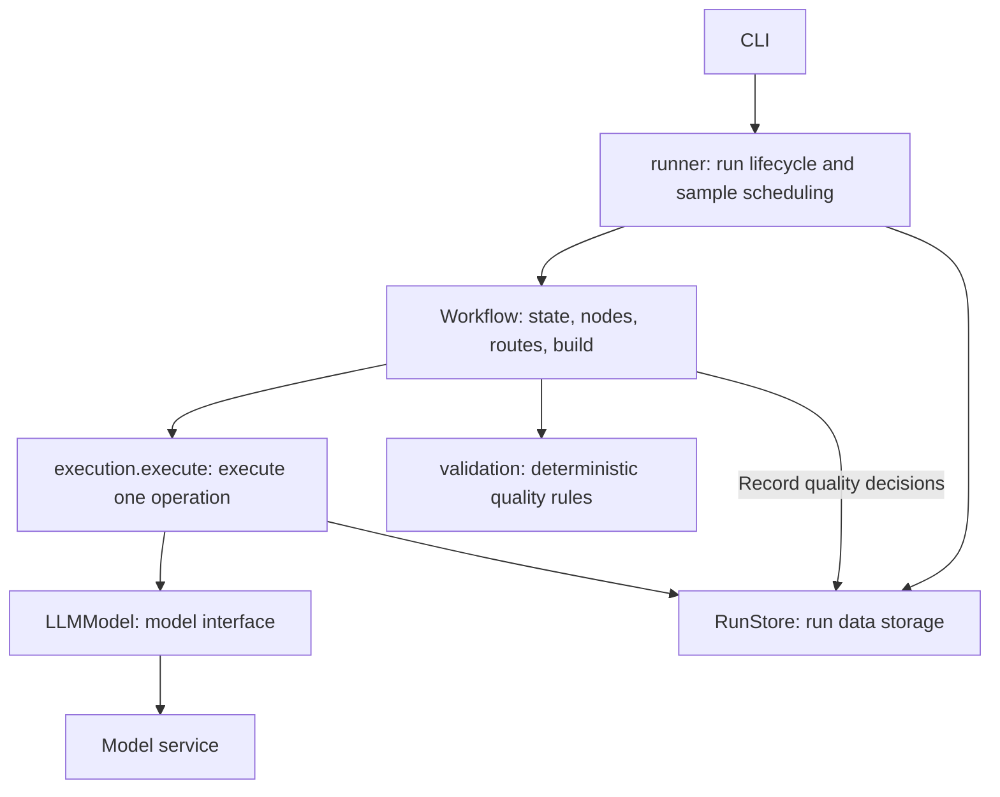

# Workflow design

[中文](workflows.md) | **English** · [Home](../README.en.md)

The [project overview](../README.en.md) defines four model tasks, one programmatic group check, and two main workflows. This document maps them to states, nodes, routes, and builders, then explains execution and recovery boundaries.

## Graph organization

The two main workflows use LangGraph `StateGraph` directly, and Expansion reuses an internal single-attempt subgraph. Each module follows **inputs and state → nodes → routes → build**. Nodes return partial state updates, and routes only choose the next node. Compiled graphs can be reused across samples.

| Scope | Module | Responsibility | State | Builder |
| --- | --- | --- | --- | --- |
| Main workflow | [source_generation.py](../src/midasdata/workflows/source_generation.py) | Generate, validate, and revise one Source | `SourceGenerationState` | `build_source_generation` |
| Main workflow | [prompt_expansion.py](../src/midasdata/workflows/prompt_expansion.py) | Expand three levels in parallel, regenerate failed levels, and check the group in code | `PromptExpansionState` | `build_prompt_expansion` |
| Internal Expansion subgraph | [expansion_attempt.py](../src/midasdata/workflows/expansion_attempt.py) | Generate and validate once at a specified level | `ExpansionAttemptState` | `build_expansion_attempt` |

`level` means the Light / Medium / Rich expansion level, with the type `ExpansionLevel`. Workflow state, audit records, and business JSONL fields consistently use this name. Expansion model requests use the sampled target count; blind validation requests contain only the Source and output text. `expansion_attempt` means one generation and validation attempt at a specified level.

## Source Generation

`draft_source` implements Generate Source, and `blind_sampler_validation` implements blind_sampler_validation. The former produces a visual concept and user description; the latter obtains a validation report and computes a quality decision.

Inputs are `task_id` and the five-dimensional sampled `conditions`. Runtime state contains the current `concept`, `draft_prompt`, `draft_count`, `validation`, `decision`, `revision_feedback`, `failure_reason`, and terminal `result`.

`planning.source_tasks` determines the task sequence from the seed before concurrent execution, implementing the Sample stage of the business flow. The graph receives already sampled conditions. Revisions do not resample and normally retain the previous concept, changing it only when the concept itself conflicts with the conditions.

Successfully replacing a draft clears its current validation, decision, and feedback. If validation of the new draft fails technically, the result retains the new text without attaching old evidence. If generating a replacement fails, the old text has not been replaced, so it and its corresponding evidence can remain. Historical responses stay in the audit log.

## Expansion

`expand_prompt` invokes the single-attempt subgraph for generation, semantic blind validation, and code checks at each level. The parent samples targets, manages branch convergence and regeneration of failed levels, then the programmatic `group_check` node decides group acceptance.

Inputs are `task_id` and `source_prompt`. Runtime state contains the fixed per-level `piu_targets`, `round_number`, `pending_levels`, the latest per-level `expansions`, `group_decision`, `failure_reason`, and terminal `result`.

The first round dispatches all three levels; later rounds dispatch only failed levels. `merge_expansions` merges parallel results and prevents older rounds from overwriting newer ones. LangGraph waits for all dispatched branches to finish before running `evaluate_round`, which also checks the round number.

`initialize_expansion` uniformly samples an integer from each level's configured inclusive range and stores the targets in `piu_targets`. Seeds derive from the run ID, task ID, and level, ensuring the same targets on resume.

`prepare_round` increments the round. `dispatch_attempts` allocates the next `draft_number` for each pending level and supplies the original Source and fixed target count. Each level allows at most three generations. Only failed levels are generated again; a required level without remaining budget rejects the group.

`group_check` calls `assess_group` to require exactly the three expected levels, matching level identifiers, nonblank prompts, and passing statuses, semantic reports, and code decisions. Failure rejects the group; success produces three business and SFT records. Its decision is audited under the `group_check` stage without a model request event.

### Internal subgraph: single expansion attempt

`draft_expansion` implements Expand, and `blind_expand_validation` implements blind_expand_validation. The subgraph receives one attempt allocated by the parent, generates text, and returns its validation result.

Inputs include `task_id`, `source_prompt`, `level`, `round_number`, `draft_number`, and `target_added_pius`. Runtime state contains this attempt's `draft_prompt`, `validation`, `decision`, `failure_reason`, and `ExpansionResult`.

`initialize_attempt` initializes the current draft and validation state; the parent supplies the target count.

Every generation request contains only `source` and `target_added_pius`, and the generator returns `ExpansionDraft(prompt)`. Blind validation requests contain only `source` and `output`. `BlindExpansionValidation` returns semantic `passed`, `reason`, and independently identified `added_pius`; the node uses `assess_expansion` to check the level's range, evidence, duplicates, and basic format, without requiring the count to equal the generation target.

The parent manages generation budgets. The subgraph generates and validates once, returning `passed`, `quality_failed`, or `technical_failed`. Failed generation skips validation; technical failure during validation retains the current draft with empty current evidence. Failure reasons are saved in results and operation records.

## Model calls and execution boundaries

- `runner.py` creates generator and validator models and a shared `ExecutionContext`, passes dependencies to workflow build functions, and schedules samples.
- Workflow nodes prepare business inputs and prompts and choose a model. After receiving a report, validation nodes explicitly call `assess_source` or `assess_expansion`, save the quality decision, and return state updates. Routes use the result and generation budget to choose the next step.
- `execution.py` provides `execute()`, which receives an async operation returning a persistable dictionary, inputs, audit identifiers, a parser, and retry rules. It checks history, executes the operation, records output, and returns the parsed result. It also supports ordinary operations that do not use a model.
- `model.py` provides `LLMModel`, which holds only one model's configuration and connection and handles requests, interface error classification, and response parsing. It neither reads run history nor accepts quality assessment functions.
- `storage.py` provides `RunStore`, which manages the run lock and saves configuration, tasks, operation records, quality decisions computed by nodes, and committed results.

`schemas.py` defines response and storage contracts, `planning.py` plans tasks, `exports.py` produces exports, and `preview.py` builds offline previews. The CLI handles arguments and result reporting. Nodes do not hold per-sample object state or export files directly.

`ExecutionContext` contains only `store`, a concurrency semaphore, and backoff parameters. It contains no workflow state, model instances, or business rules. Ordinary initialization, round calculations, parallel result merging, and routing happen directly in workflows.

A new operation has no history and starts with its first attempt. When history exists, the execution layer reuses saved outputs or restores the number of attempts already used. Operation output is persisted before parsing and validation. The model's `invoke()` returns a raw response snapshot, and `parse()` parses either new or historical responses, so malformed raw outputs remain in the audit log.

After `execute()` returns a parsed blind report, its node computes the code-side `QualityDecision` and saves it through `RunStore.record_decision()`. `group_check` computes and records its decision directly. Replay does not append the same quality decision twice.

JSON and schema errors are technical errors. Structurally valid reports return normally; semantic or code check failures trigger another generation: Source uses feedback for revision, while Expansion regenerates from the original Source and fixed target. Deterministic checks do not guarantee that the model's semantic judgments are correct.

Each operation explicitly specifies retryable errors and its maximum attempts, defaulting to one execution. Model operations allow at most five attempts, including the first. Network errors, timeouts, HTTP 408/409/429, 5xx errors, and invalid responses can be retried; other HTTP errors stop the run. SDK retries are disabled. The execution layer uses an ordinary `for` loop with exponential backoff and jitter. Backoff waits do not occupy concurrency slots.

Sample workers and all parallel levels share one execution semaphore, allowing at most `concurrency` model requests in flight. File writes run synchronously in the event loop, without concurrent writer threads.

## Recovery and versions

Recovery replays uncommitted tasks from the workflow entry point, without graph checkpoints. An operation is identified by task ID, stage name, expansion level, round, and generation number, represented by `logical_call_id`. Saved successful responses are parsed again and reused; a saved raw response alone can also be recovered. Request events are fsynced before requests are sent, so an unknown outcome still consumes a technical attempt.

Recovery requires matching requests, configuration, the sampler, prompt digests, software version, and `WORKFLOW_REVISION`. `concurrency` and preview page size may change; other configuration must remain the same. Run metadata and fingerprints are checked together during recovery.

A complete but invalid audit line or a corrupted task sequence blocks recovery. Only an incomplete final append without a newline is discarded. Committed passed and rejected tasks are both skipped, while exports and previews are rebuilt from committed results.
