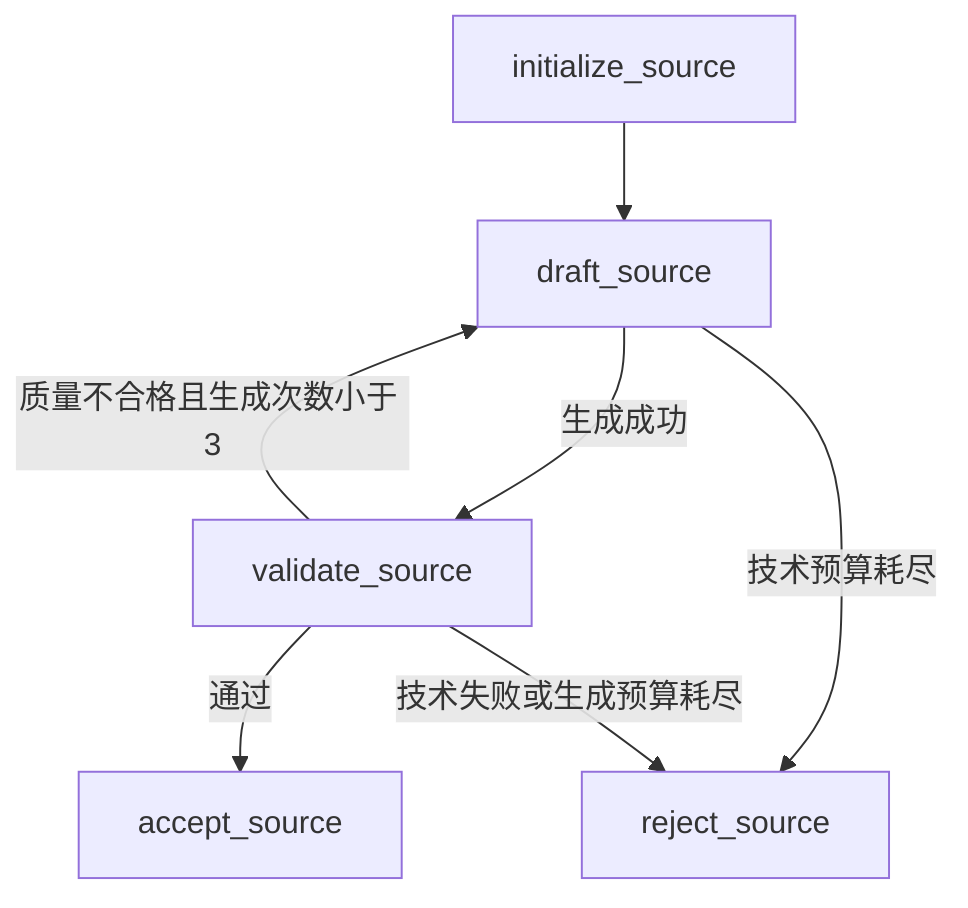
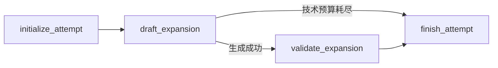
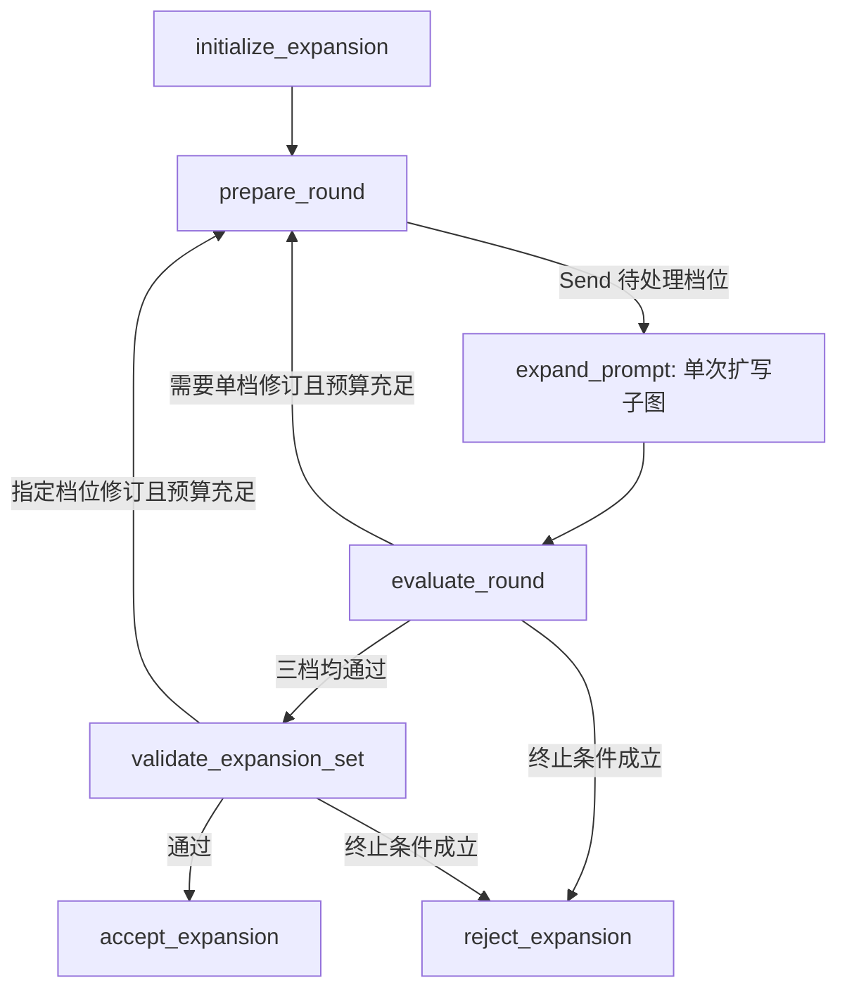
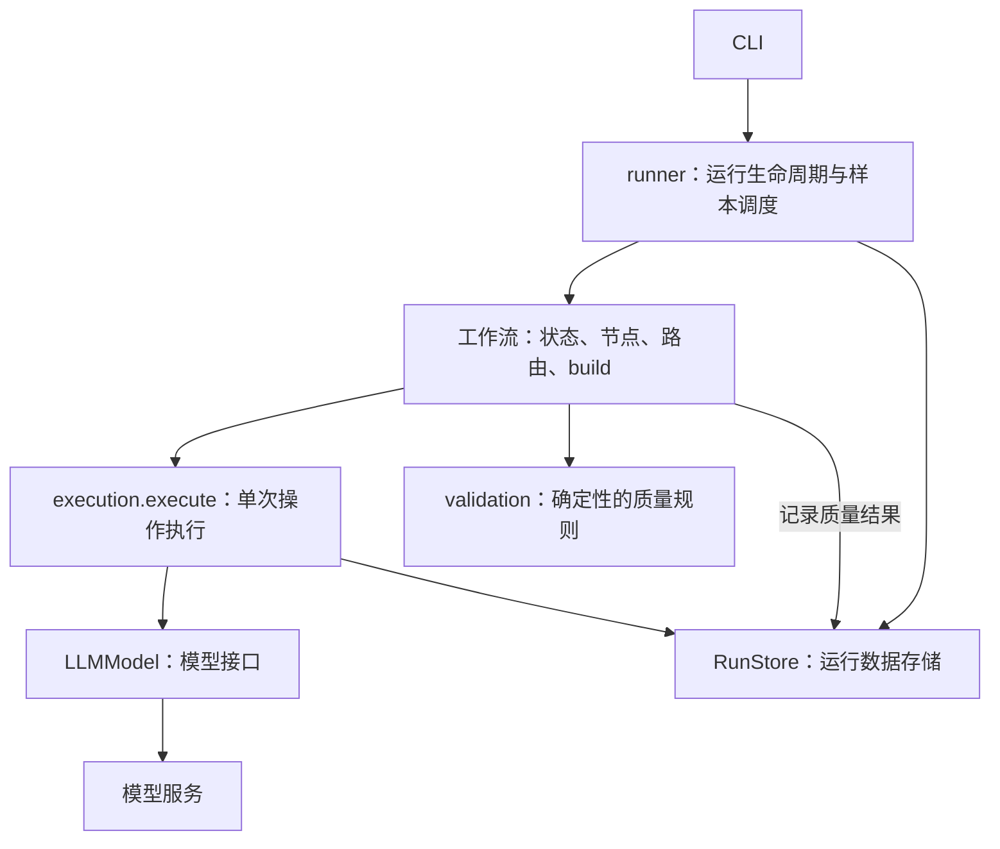

# 工作流与恢复

**中文** | [English](workflows.en.md) · [首页](../README.md)

工作流直接使用 LangGraph `StateGraph`。每个模块按 **输入与状态 → 节点 → 路由 → build** 排列。节点返回局部状态更新，路由只决定下一个节点；编译后的图可以被多个样本复用。

| 模块 | 含义 | 状态 | 构建入口 |
| --- | --- | --- | --- |
| `workflows/source_generation.py` | 生成并修订一条视觉源描述 | `SourceGenerationState` | `build_source_generation` |
| `workflows/expansion_attempt.py` | 指定档位的一次生成与校验 | `ExpansionAttemptState` | `build_expansion_attempt` |
| `workflows/prompt_expansion.py` | 并行扩写三档、定向修订、组校验 | `PromptExpansionState` | `build_prompt_expansion` |

`level` 表示 Light / Medium / Rich 扩写等级，类型为 `ExpansionLevel`；工作流状态、模型调用和 JSONL 字段统一使用这一名称。`expansion_attempt` 表示指定等级的一次生成与校验。

## 源描述生成

输入是 `task_id` 和五维采样 `conditions`。运行状态包含当前 `concept`、`draft_prompt`、`draft_count`、`validation`、`decision`、`revision_feedback`、`failure_reason` 和终态 `result`。

`planning.source_tasks` 在并发执行前按种子确定任务序列。修订沿用原采样条件和上一版概念，不重新采样。

成功替换草稿会清空当前校验、决策和反馈。新草稿的校验请求失败时，结果保留新文本，但不附带旧证据。若生成替代草稿失败，旧文本没有被替换，旧文本和对应证据仍可保留。历史响应一直保存在审计日志里。

## 单次扩写尝试

输入包含 `task_id`、`source_prompt`、`level`、`round_number`、`draft_number`、`previous_prompt` 和 `revision_feedback`。运行状态包含本次 `draft_prompt`、`validation`、`decision`、`failure_reason` 和 `ExpansionResult`。

这个子图没有质量修订循环。父图分配生成次数，子图只返回 `passed`、`quality_failed` 或 `technical_failed`。生成失败不会调用校验器；校验失败会保留本次草稿和空的当前证据。每档只接收源描述及自己的历史输出，不接收其他档位的文本。

## 三档扩写编排

输入是 `task_id` 和 `source_prompt`。运行状态包含 `round_number`、`pending_levels`、各档最新 `expansions`、`feedback_by_level`、`set_validation`、`set_decision`、`failure_reason` 和终态 `result`。

第一轮分派三档，后续只分派需要修订的档位。`merge_expansions` 合并并行返回值，不允许旧轮次覆盖新轮次。LangGraph 汇合当前分派的所有分支后才运行 `evaluate_round`，该节点还会检查轮次。

`prepare_round` 增加轮次并清空旧组证据。`dispatch_attempts` 为每个待处理档位分配下一次 `draft_number`。单档质量失败和组校验指定修订，共享每档最多三次生成预算；任一所需修订档位没有预算就拒绝整组。

只有三档均通过单档校验后才调用组校验。组校验共享一次源 PIU 提取。任一作用域的 `insufficient_expansion_space` 都终止整组；终止前会等待本轮并行尝试完成。整组通过才产生 Light、Medium、Rich 三条业务记录和 SFT 记录。

## 模型调用与执行边界

- `runner.py` 创建生成模型、校验模型和共享的 `ExecutionContext`，把依赖传给工作流的 build 函数，并调度多个样本。
- 工作流节点准备业务输入和提示词，选择模型；校验节点拿到报告后显式调用 `assess_source`、`assess_expansion` 或 `assess_expansion_set`，保存质量结果并返回状态更新。路由结合结果和修订预算决定下一步。
- `execution.py` 的 `execute()` 接收一个返回可落盘字典的异步操作、输入、审计标识、解析函数和重试规则。它查询历史、执行操作、记录输出并返回解析结果，也支持普通的非模型操作。
- `model.py` 的 `LLMModel` 只持有一个模型的配置和连接，负责请求、接口错误分类及响应解析。它不读取运行历史，也不接受质量判断函数。
- `storage.py` 的 `RunStore` 管理运行锁，保存配置、任务、操作记录、节点计算出的质量结果和已提交结果。

`ExecutionContext` 只包含 `store`、并发信号量以及退避参数，不包含工作流状态、模型实例或业务规则。普通的初始化、轮次计算、并行结果合并和路由直接在工作流中执行。

首次操作没有历史记录，直接从第一次尝试开始；有历史记录时，执行层复用已保存输出或恢复已用次数。操作输出先落盘，再执行解析检查。模型的 `invoke()` 返回原始响应快照，`parse()` 解析新响应或历史响应，因此格式错误的原始输出也能保留在审计日志中。

组校验节点提供的 `parse_set_report()` 除了解析 schema，还调用 `check_expansion_set_contract()` 检查三个等级、修订列表和反馈是否完整自洽。它只返回报告。节点在 `execute()` 返回后再计算 `QualityDecision`，并通过 `RunStore.record_decision()` 保存；重放不会重复追加同一条质量决策。

JSON、schema 和组修订契约错误属于技术错误。合约完整但质量不合格的报告正常返回，由工作流决定生成修订。确定性的规则检查不保证模型给出的语义判断一定正确。

每个操作显式指定可重试错误和最大尝试次数，默认只执行一次。模型操作最多五次，包括第一次；网络错误、超时、HTTP 408/409/429、5xx 和非法响应可以重试，其他 HTTP 错误停止运行。SDK 重试关闭，执行层使用普通 `for` 循环、指数退避和抖动。退避等待不占并发槽位。

样本 worker 和所有并行等级共享同一个执行信号量；最多有 `concurrency` 个模型请求同时在途。文件写入在事件循环内同步完成，没有并发写入线程。

## 恢复与版本

恢复从工作流入口重放未提交任务，不使用图 checkpoint。操作身份由任务 ID、阶段名称、扩写等级、轮次和生成序号确定，以 `logical_call_id` 标识。已保存的成功响应会重新解析并复用；仅保存原始响应也可以恢复。请求事件在发出请求前 fsync，所以未知结果仍消耗技术次数。

恢复必须匹配请求、配置、采样器、提示词摘要、软件版本和 `WORKFLOW_REVISION`。`concurrency` 和预览页大小可以改变，其他配置必须一致。恢复时统一检查运行元数据和指纹。

完整但非法的审计行或损坏的任务序列会阻止恢复。只有最后一行缺少换行时，才丢弃这一未完成追加。已提交的通过和拒绝任务都会跳过，导出与预览则从提交结果重建。
