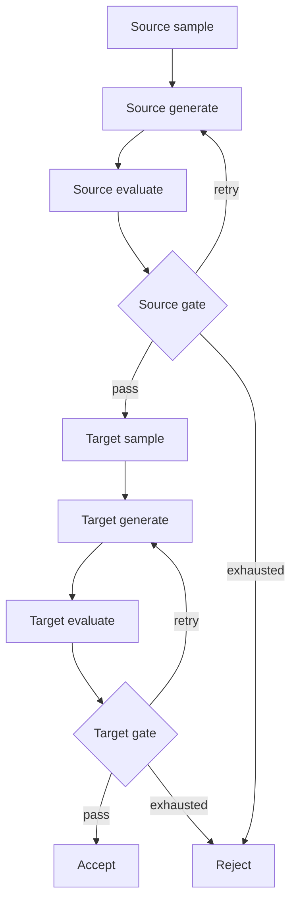

# 工作流

**中文** | [English](workflows.en.md) · [首页](../README.md)

固定图定义在 [pipeline.py](../src/pairdata/workflows/pipeline.py)，状态、节点、路由和 build 位于同一模块。Recipe 控制行为，图拓扑由代码固定。

输入为稳定 task_id 和任务 index。每阶段保存 sample、generation_attempt、generation、candidate、evaluation、decision、status 和 reason。新生成尝试建立新的阶段结果，清空旧候选及证据；历史保留在 Audit 中。

Source 和 Target 均可在 recipe 中绑定 previous 与 feedback 进行修订。previous 为该阶段上一轮候选，feedback 包含其 evaluation 和程序 decision；首次生成两者均为 null。Target Generate 的上下文包含已通过的 source、自身 sample、previous、feedback，模板仅看到显式绑定的变量。

各阶段第一次生成前采样并落盘；后续质量重生成只循环 generate/evaluate/gate。Target 不通过不影响已通过的 Source。生成预算或技术请求预算耗尽会拒绝任务。

## 执行分层

| 模块 | 职责 |
| --- | --- |
| config / recipe | 加载并编译全部配置、模板、Schema 和规则 |
| sampler / prompts / validation / rules | 通用采样、渲染、结构校验、程序判定 |
| workflows/pipeline | 固定节点、阶段状态、质量预算与路由 |
| model | LangChain 调用、原始响应与服务错误分类 |
| execution | 操作重放、共享信号量、技术重试及持久化事件 |
| runner | 任务队列、并发 worker、终态提交与派生导出 |
| storage | 目录锁、原子文件、审计、配置快照 |

图节点和路由均使用异步入口，状态更新与审计写入在同一事件循环内执行，避免同步节点被自动送入线程池。

每个逻辑请求默认最多尝试五次，可重试网络错误、超时、408/409/429、5xx、JSON 和响应校验错误。SDK 重试关闭，退避等待不占并发槽位。其它服务错误停止运行。评估成功解析后，Gate 独立计算并记录质量决策。

## 恢复

不用图 checkpoint。未提交任务从入口重放，按 task_id、阶段操作名、generation_attempt 复用成功响应。请求事件在实际请求前 fsync，未知结果仍消耗预算；响应已保存但 success 未追加时，可重新解析该响应并补齐事件。

采样事件按任务与阶段唯一保存，恢复会检查重新计算结果与历史一致。已提交的通过和拒绝任务都跳过；导出按任务顺序重建。规则决策重放不重复追加。

目录锁阻止并发写入同一运行。tasks.jsonl 和 recipe.json 检查摘要；完整非法的审计行阻止恢复，仅丢弃没有换行的最后一次未完成追加。
