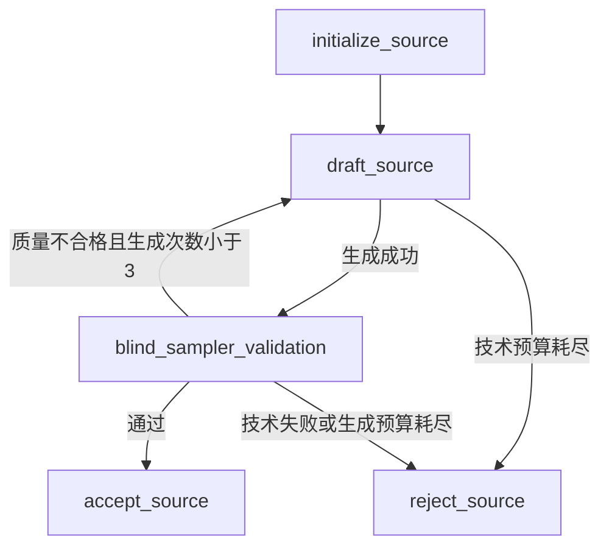
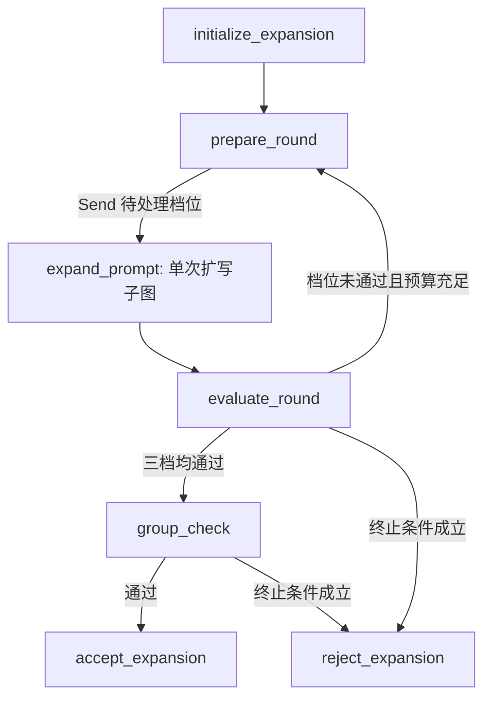
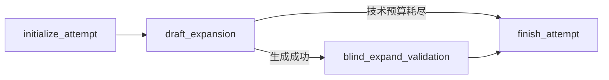
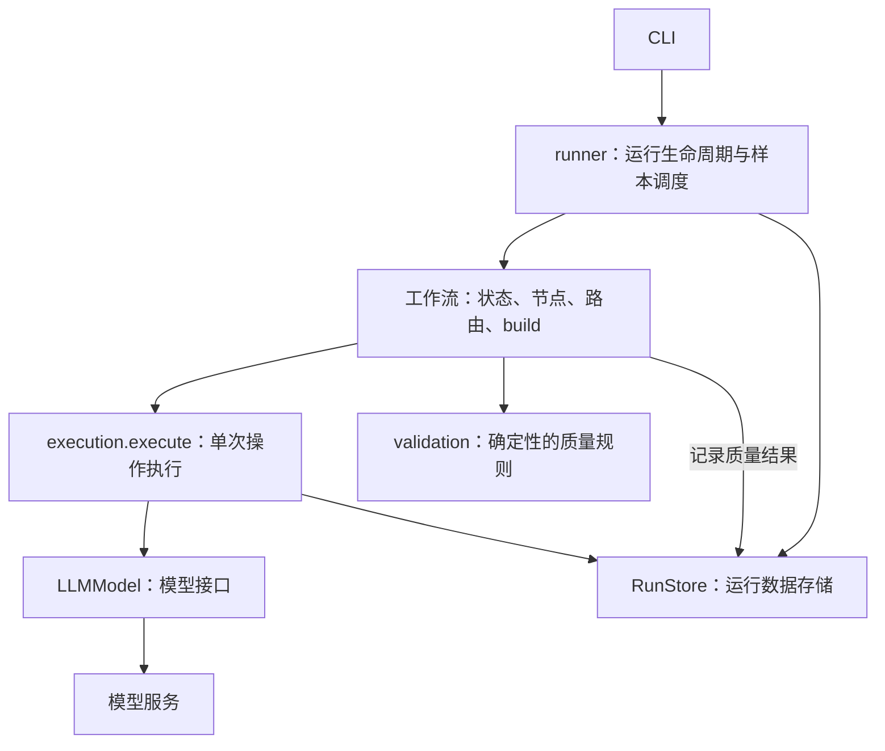

# 工作流设计

**中文** | [English](workflows.en.md) · [首页](../README.md)

[项目概览](../README.md)定义四个模型任务、一个程序组检查及两个主工作流。这里说明它们如何映射到状态、节点、路由和构建函数，以及执行与恢复的边界。

## 图的组织

两个主工作流直接使用 LangGraph `StateGraph`，Expansion 内部复用一个单次扩写子图。每个模块按 **输入与状态 → 节点 → 路由 → build** 排列。节点返回局部状态更新，路由只决定下一个节点；编译后的图可以被多个样本复用。

| 层级 | 模块 | 职责 | 状态 | 构建入口 |
| --- | --- | --- | --- | --- |
| 主工作流 | [source_generation.py](../src/midasdata/workflows/source_generation.py) | 生成、校验并修订一条 Source | `SourceGenerationState` | `build_source_generation` |
| 主工作流 | [prompt_expansion.py](../src/midasdata/workflows/prompt_expansion.py) | 并行扩写三档、失败档位重生成、程序组检查 | `PromptExpansionState` | `build_prompt_expansion` |
| Expansion 内部子图 | [expansion_attempt.py](../src/midasdata/workflows/expansion_attempt.py) | 指定档位的一次生成与校验 | `ExpansionAttemptState` | `build_expansion_attempt` |

`level` 表示 Light / Medium / Rich 扩写等级，类型为 `ExpansionLevel`；工作流状态、审计记录和业务 JSONL 字段统一使用这一名称。扩写模型请求使用抽取的目标数量，盲校验请求只包含 Source 和输出文本。`expansion_attempt` 表示指定等级的一次生成与校验。

## Source Generation：源描述生成

`draft_source` 承担 Generate Source，`blind_sampler_validation` 承担 blind_sampler_validation。前者生成视觉概念与用户描述，后者取得校验报告并计算质量决策。

输入是 `task_id` 和五维采样 `conditions`。运行状态包含当前 `concept`、`draft_prompt`、`draft_count`、`validation`、`decision`、`revision_feedback`、`failure_reason` 和终态 `result`。

`planning.source_tasks` 在并发执行前按种子确定任务序列，完成业务流程中的 Sample 阶段；图接收已经确定的采样条件。修订不重新采样，通常沿用上一版概念，只有概念本身与采样条件冲突时才调整。

成功替换草稿会清空当前校验、决策和反馈。新草稿的校验请求失败时，结果保留新文本，但不附带旧证据。若生成替代草稿失败，旧文本没有被替换，旧文本和对应证据仍可保留。历史响应一直保存在审计日志里。

## Expansion：三档扩写编排

`expand_prompt` 调用单次扩写子图执行各档生成、语义盲校验和程序规则检查。父图抽取目标、管理并行汇合与失败档位重生成，最后由纯程序节点 `group_check` 决定整组是否可接受。

输入是 `task_id` 和 `source_prompt`。运行状态包含各档固定目标 `piu_targets`、`round_number`、`pending_levels`、各档最新 `expansions`、`group_decision`、`failure_reason` 和终态 `result`。

第一轮分派三档，后续只分派未通过的档位。`merge_expansions` 合并并行返回值，不允许旧轮次覆盖新轮次。LangGraph 汇合当前分派的所有分支后才运行 `evaluate_round`，该节点还会检查轮次。

`initialize_expansion` 从各档位配置的闭区间内分别均匀抽取一个整数，保存到 `piu_targets`。随机种子由运行 ID、任务 ID 和 level 确定，保证恢复时目标一致。

`prepare_round` 增加轮次。`dispatch_attempts` 为每个待处理档位分配下一次 `draft_number`，传入原 Source 和固定目标数量。每档最多生成三次；只有未通过的档位继续生成，任一所需档位没有预算就拒绝整组。

`group_check` 调用 `assess_group`，检查固定三档是否齐全、等级匹配、文本非空，以及每档状态、语义报告和程序决策是否都已通过。失败就拒绝整组，通过后产生三条业务记录和 SFT 记录。整组决策以 `group_check` 阶段写入审计日志，没有模型请求事件。

### 内部子图：单次扩写尝试

`draft_expansion` 承担 Expand，`blind_expand_validation` 承担 blind_expand_validation。子图接收父图分配的一次尝试，生成文本并返回校验结果。

输入包含 `task_id`、`source_prompt`、`level`、`round_number`、`draft_number` 和 `target_added_pius`。运行状态包含本次 `draft_prompt`、`validation`、`decision`、`failure_reason` 和 `ExpansionResult`。

`initialize_attempt` 初始化本次草稿与校验状态，目标数量由父图传入。

每次生成请求都只包含 `source` 和 `target_added_pius`，生成器返回 `ExpansionDraft(prompt)`。盲校验请求只包含 `source` 和 `output`。`BlindExpansionValidation` 返回语义 `passed`、`reason` 和独立识别的 `added_pius`；节点用 `assess_expansion` 检查档位范围、证据、重复项和基本格式，不要求计数等于生成目标。

父图管理生成预算，子图执行一次生成与校验，返回 `passed`、`quality_failed` 或 `technical_failed`。生成失败不会调用校验器；校验发生技术失败时会保留本次草稿和空的当前证据。失败原因保存在结果与操作记录中。

## 模型调用与执行边界

- `runner.py` 创建生成模型、校验模型和共享的 `ExecutionContext`，把依赖传给工作流的 build 函数，并调度多个样本。
- 工作流节点准备业务输入和提示词，选择模型；校验节点拿到报告后显式调用 `assess_source` 或 `assess_expansion`，保存质量结果并返回状态更新。路由结合结果和生成预算决定下一步。
- `execution.py` 的 `execute()` 接收一个返回可落盘字典的异步操作、输入、审计标识、解析函数和重试规则。它查询历史、执行操作、记录输出并返回解析结果，也支持普通的非模型操作。
- `model.py` 的 `LLMModel` 只持有一个模型的配置和连接，负责请求、接口错误分类及响应解析。它不读取运行历史，也不接受质量判断函数。
- `storage.py` 的 `RunStore` 管理运行锁，保存配置、任务、操作记录、节点计算出的质量结果和已提交结果。

`schemas.py` 定义响应和落盘契约，`planning.py` 规划任务，`exports.py` 生成导出，`preview.py` 生成离线预览。CLI 处理参数和结果报告；节点不保存样本级对象状态，也不直接导出文件。

`ExecutionContext` 只包含 `store`、并发信号量以及退避参数，不包含工作流状态、模型实例或业务规则。普通的初始化、轮次计算、并行结果合并和路由直接在工作流中执行。

首次操作没有历史记录，直接从第一次尝试开始；有历史记录时，执行层复用已保存输出或恢复已用次数。操作输出先落盘，再执行解析检查。模型的 `invoke()` 返回原始响应快照，`parse()` 解析新响应或历史响应，因此格式错误的原始输出也能保留在审计日志中。

盲校验节点在 `execute()` 返回解析后的报告后，计算程序侧 `QualityDecision`，并通过 `RunStore.record_decision()` 保存。`group_check` 直接计算和记录整组决策。重放不会重复追加同一条质量决策。

JSON 和 schema 错误属于技术错误。结构完整的报告正常返回，语义失败或程序规则失败由工作流触发下一次生成：Source 使用反馈修订，Expansion 使用原 Source 和固定目标重新生成。确定性的规则检查不保证模型给出的语义判断一定正确。

每个操作显式指定可重试错误和最大尝试次数，默认只执行一次。模型操作最多五次，包括第一次；网络错误、超时、HTTP 408/409/429、5xx 和非法响应可以重试，其他 HTTP 错误停止运行。SDK 重试关闭，执行层使用普通 `for` 循环、指数退避和抖动。退避等待不占并发槽位。

样本 worker 和所有并行等级共享同一个执行信号量；最多有 `concurrency` 个模型请求同时在途。文件写入在事件循环内同步完成，没有并发写入线程。

## 恢复与版本

恢复从工作流入口重放未提交任务，不使用图 checkpoint。操作身份由任务 ID、阶段名称、扩写等级、轮次和生成序号确定，以 `logical_call_id` 标识。已保存的成功响应会重新解析并复用；仅保存原始响应也可以恢复。请求事件在发出请求前 fsync，所以未知结果仍消耗技术次数。

恢复必须匹配请求、配置、采样器、提示词摘要、软件版本和 `WORKFLOW_REVISION`。`concurrency` 和预览页大小可以改变，其他配置必须一致。恢复时统一检查运行元数据和指纹。

完整但非法的审计行或损坏的任务序列会阻止恢复。只有最后一行缺少换行时，才丢弃这一未完成追加。已提交的通过和拒绝任务都会跳过，导出与预览则从提交结果重建。
