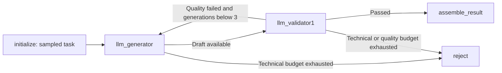
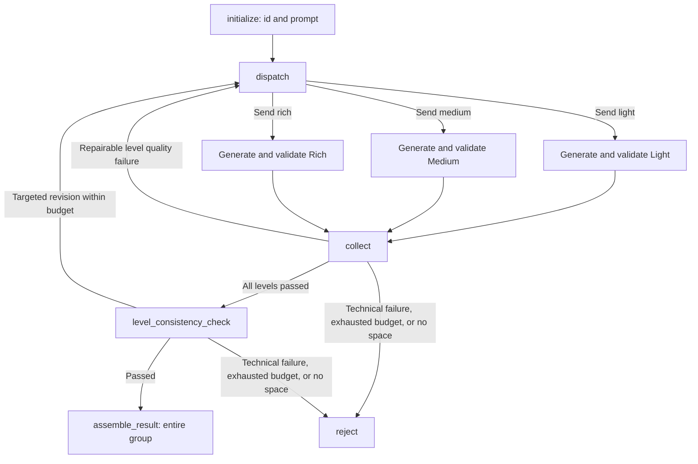

# Workflows and recovery

Both graphs use `TypedDict` state. Nested validations, decisions, level results, and sample results use Pydantic models; level maps and feedback have explicit types. Graph construction lives in `workflows/generate.py` and `workflows/expand.py`, with node behavior in `workflows/steps.py`. Model calls, validation, and storage have separate modules. Graph nodes and routing callbacks run asynchronously.

## Source-description generation

The generator chooses a visual concept and source description in one `SourceDraft`. Conditions come from the persisted five-dimensional task; `language` chooses Chinese, English, or mixed text independently of expression style, and omitted dimensions impose no restriction. Revisions do not resample. The current prompt allows a revision to improve condition matching and description quality; the returned concept belongs to the current draft and may change with that revision.

`concept` is the generator's short description of its chosen visual theme, returned alongside `prompt` in the same request. Initialization supplies an empty concept; revisions receive the previous concept and description, and a successful replacement updates both. The preview displays the current returned concept. It is retained in internal results and lineage; expansion consumes the full `prompt` text.

Generation and validation have separate technical retry boundaries. A validator's technical failure does not regenerate an existing draft. Exhausting either call's technical budget rejects the sample; a quality failure can revise the draft while its generation budget remains.

A successful replacement draft clears current `validation`, `decision`, and feedback. If its validator later exhausts technical retries, the rejected result retains the new text with empty current validation and decision. If generating the replacement fails, the previous text was not replaced, so its matching evidence may remain. Prior responses and the feedback supplied to revisions stay in the audit log.

`initialize` sets up graph state, and `assemble_result` / `reject` construct terminal results. Sampling and task persistence happen in `RunStore.prepare` before the graph starts. The executor calls `RunStore.commit` after the graph returns, then `RunStore.export` derives output files. Graph nodes do not write exports.

## Three-level expansion

The first round issues exactly three `Send` tasks, one per level. Each task runs the same single-level subgraph for one generation and one validation; it has no internal quality-revision loop. The generator receives the source text, current level, PIU range, that level's previous output, and revision feedback. It receives no other level's output. English sources undergo faithful normalization at Light and visual expansion at Medium/Rich, using the same PIU rules.

A generation technical failure ends the single-level subgraph without running its validator. A successful generation clears the subgraph's current result. If validation then fails technically, the resulting `LevelResult` contains the new output with no validation or decision. If generation fails before producing text, the current round's level result has an empty prompt; earlier text remains in the audit and may have been supplied as `previous_output`.

LangGraph supersteps wait for every dispatched task in the round before `collect`; the program also checks their round numbers. Results are merged by level, and an older round cannot overwrite a newer round. Levels not selected for revision retain their latest results.

Each `dispatch` starts a new round and clears previous `group_validation` and `group_decision`. Feedback remains available to the requested levels, and previous group evidence stays in the audit. A later failed round therefore cannot attach the old group validation to new text.

Single-level quality failures revise only failing levels. Group validation runs only when all three levels have passed individually, extracts source PIUs once at the top level, and assesses each level against that shared list. A repairable group failure supplies `retry_levels` and feedback; only those requested levels are dispatched. An insufficient-space flag from an individual or group decision immediately rejects the entire group after the current round completes.

Single-level and group revisions share a maximum of three generations per level. If any required revision level has exhausted that budget, the group is rejected. With these limits, one group has at most nine logical generations, nine single-level validator calls, and seven group validator calls. Technical attempts are counted separately within each logical call.

## Model calls, retries, and concurrency

Attempt limits live in `limits.py`: three generations and five technical attempts, including the first attempt. LangChain `Runnable.with_retry` provides the single technical retry boundary; the SDK uses `max_retries=0`. Requests, response parsing, schema checks, and stage-specific parsing callbacks share that boundary. Backoff is exponential with jitter, bounded by `retry_initial` and `retry_max`; waiting does not hold a request semaphore slot.

`ModelCaller` owns separate generation and validation `ChatOpenAI` instances. `call` restores history, checks the remaining budget, and then invokes the retry wrapper. `_restore_history` reuses saved results and restores request counts. `_request_once` performs one request, response parsing, and audit writes. Native mode uses `with_structured_output`; both fresh and restored responses pass through `parse_response` and the same callbacks.

Source and single-level English quality decisions are computed after response parsing. Group assessment runs in the parsing callback so structural and revision-contract errors can retry the validator call; the callback's decision is reused for audit and routing.

The executor uses an asynchronous queue of capacity `2 * concurrency` and `concurrency` sample workers. Model requests across all samples and levels share one semaphore. Storage calls run synchronously in the executor's event loop, without concurrent writer threads.

Retryable failures include timeouts, connection errors, invalid JSON/schema responses, and HTTP 408/409/429 or 5xx responses. Other provider HTTP errors stop the run with a configuration error. Exhausted retryable calls reject their current sample; ordinary quality failures use the generation budget.

## Recovery and exports

Recovery replays uncommitted samples from the graph entry point. Logical call IDs are stable. Saved successes are parsed and reused without new requests; a saved raw response without a success event is also parsed and recovered if valid. Unresolved request attempts consume the technical budget. Replayed quality feedback and generation counts preserve revision budgets. Committed rejected samples are skipped just like passed samples.

The fingerprint includes the request, sampler, all configuration except `concurrency` and `preview_page_size`, software version, prompt versions and file content digest, and SFT version. Expansion requests contain the resolved input path and digest. The saved task file has a separate integrity digest, and individual calls check their saved input payload digest. Any mismatch blocks recovery.

Recovery truncates only a final audit line missing its terminating newline; invalid newline-terminated events block recovery instead of resetting budgets. Every request event is fsynced before sending the request, so an unknown outcome still counts as an attempt.

The executor commits each terminal sample atomically before exporting derived files. Interrupted runs export available results and previews with status `interrupted`, or `stopped` for configuration errors. Successful processing exports with status `exporting`, writes the preview, then marks the manifest `complete`. `--resume` reconstructs exports and previews from the independent committed results; cross-file export replacement is not a single transaction.
